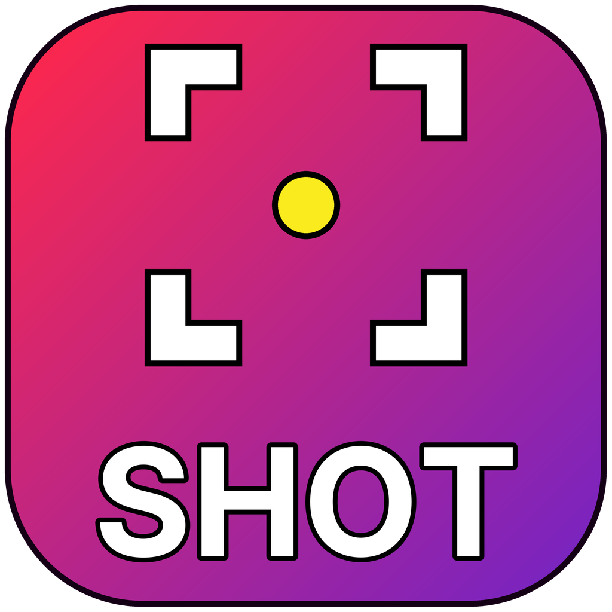
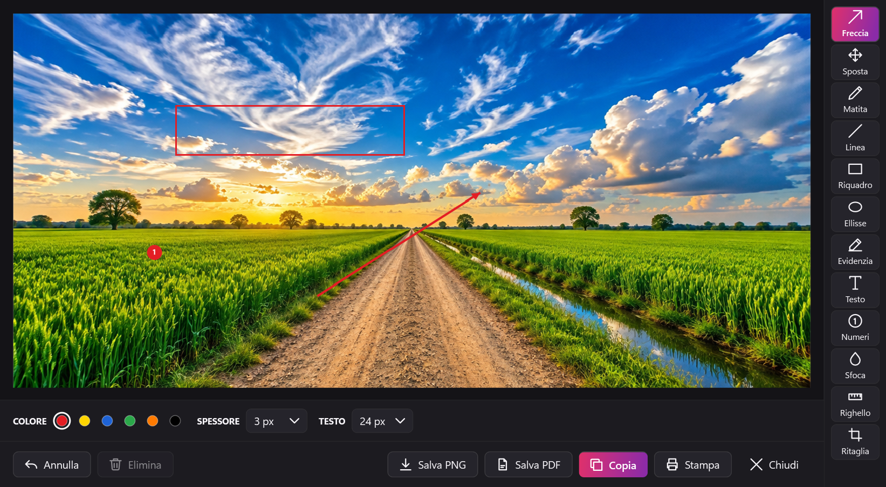
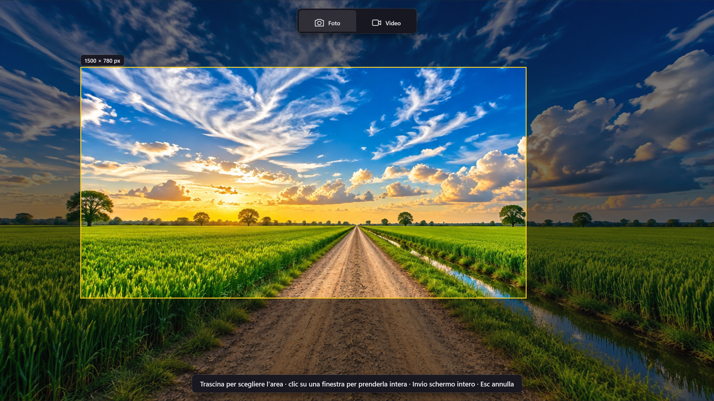
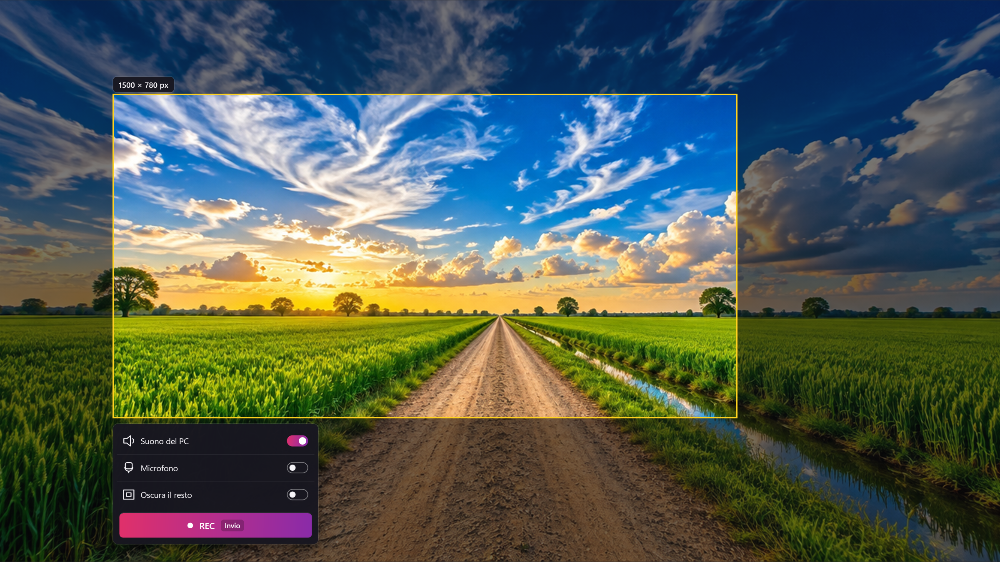
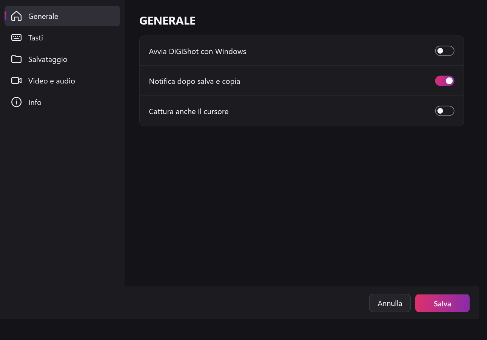
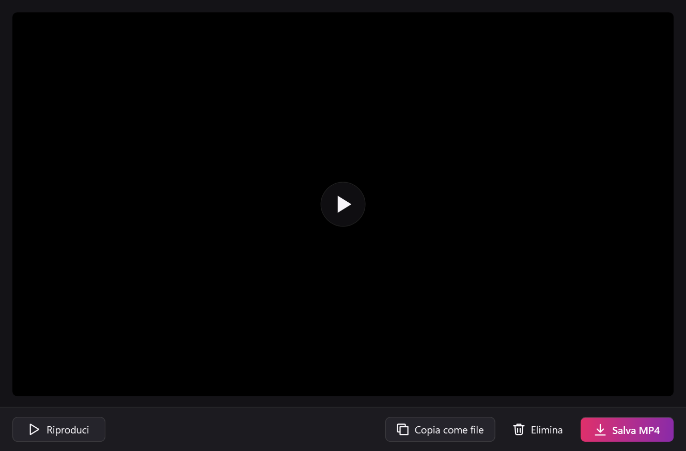
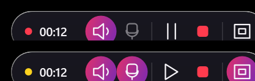

  

  

# DiGiShot

## 📸 Screenshot con editor e registrazione dello schermo su Windows, senza cloud e senza account

### ⬇️ [Scarica DiGiShot](https://github.com/DiGi-Apps-Dev/DiGiShot/releases/latest)

Le schermate e i video restano sul tuo PC. DiGiShot fa parte di **DiGi Apps**, app gratuite per Windows.

### Cosa fa

- **Un tasto e scegli l'area:** lo schermo si congela, trascini per scegliere la parte che vuoi, oppure un clic prende una finestra intera e Invio tutto lo schermo. Funziona anche con più monitor.
- **Foto con l'editor:** frecce, linee, riquadri, ellissi, evidenziatore, testo, numeri progressivi, sfocatura, righello in pixel e ritaglio. Ogni elemento si può spostare o eliminare dopo. Le frecce quasi dritte diventano dritte da sole.
- **Salva PNG, Salva PDF, Copia o Stampa:** un clic e l'editor si chiude. Copia mette l'immagine negli appunti, pronta da incollare.
- **Video dell'area scelta** in MP4, con suono del PC e microfono a scelta, Pausa e Stop, e l'opzione **Oscura il resto** che copre quello che non registri.
- **Alla fine del video:** anteprima ferma sul primo fotogramma, Salva MP4, Copia come file o Elimina.
- **Sempre a portata di mano:** sta vicino all'orologio, parte con Windows se vuoi, i tasti si cambiano nelle Impostazioni.

## Come si vede

  

| | |
|---|---|
|  |  |

| | |
|---|---|
|  |  |

  

## Installazione

Scarica `DiGiShot-Setup-<versione>.exe` dalla pagina **Releases** e aprilo con un doppio clic.
L'installatore contiene già tutto quello che serve, anche il componente .NET di Microsoft: non scarica niente da internet e non chiede la password di amministratore.

### Avviso di Windows: «Windows ha protetto il PC»

L'installatore non ha la firma digitale, quindi la prima volta Windows mostra una finestra blu.

1. Clicca su **Ulteriori informazioni** (è una scritta sotto il testo, non un pulsante grande).
2. Compare il pulsante **Esegui comunque**: cliccalo.

### L'antivirus dice che il file è sconosciuto

Alcuni antivirus avvisano con file nuovi e non firmati anche se sono sani. Scegli «Consenti» o «Aggiungi un'eccezione» (i nomi cambiano da antivirus ad antivirus). Se invece l'antivirus indica il nome preciso di un virus, non andare avanti.

## Tasti rapidi

| Tasti | Cosa fanno |
|---|---|
| Ins | cattura una schermata |
| Ctrl+Ins | registra un video (e lo ferma) |
| Invio | prende lo schermo intero / avvia la registrazione |
| Esc | annulla |
| Maiusc (mentre disegni) | linea o freccia sempre dritta |
| Ctrl+Z · Canc | annulla l'ultima modifica · elimina l'elemento selezionato |
| Ctrl+C · Ctrl+S | copia · salva PNG |

Ins e Ctrl+Ins si cambiano in Impostazioni › Tasti.

## Requisiti

- Windows 10 versione 2004 o più recente, oppure Windows 11, a 64 bit.
- Un microfono, se vuoi la voce nei video.

## Disinstallare

Impostazioni di Windows › App › App installate › DiGiShot. Le tue impostazioni e i file salvati restano.

## Licenza

DiGiShot è gratuito, con licenza **MIT** (vedi [LICENSE](LICENSE)). Usa componenti di terze parti con le loro licenze (NAudio, PDFsharp, Vortice.Windows): l'elenco completo è in [THIRD-PARTY-NOTICES.md](THIRD-PARTY-NOTICES.md), installato anche insieme al programma.
